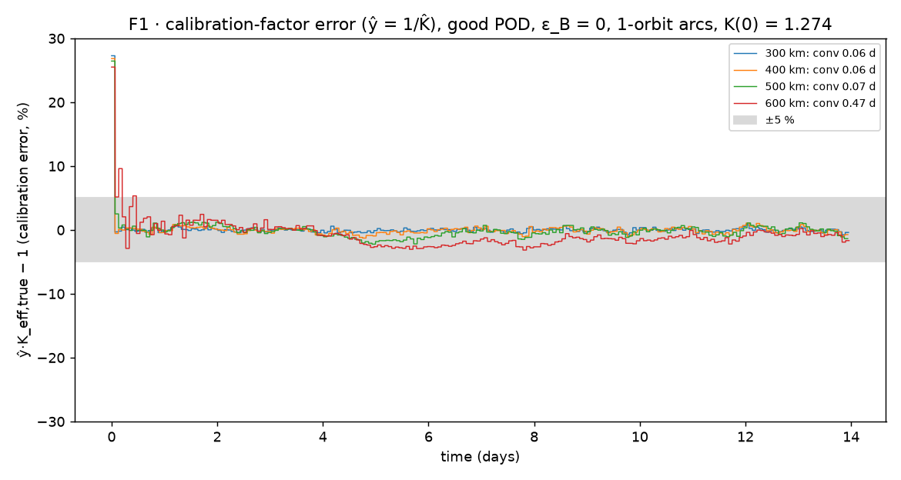
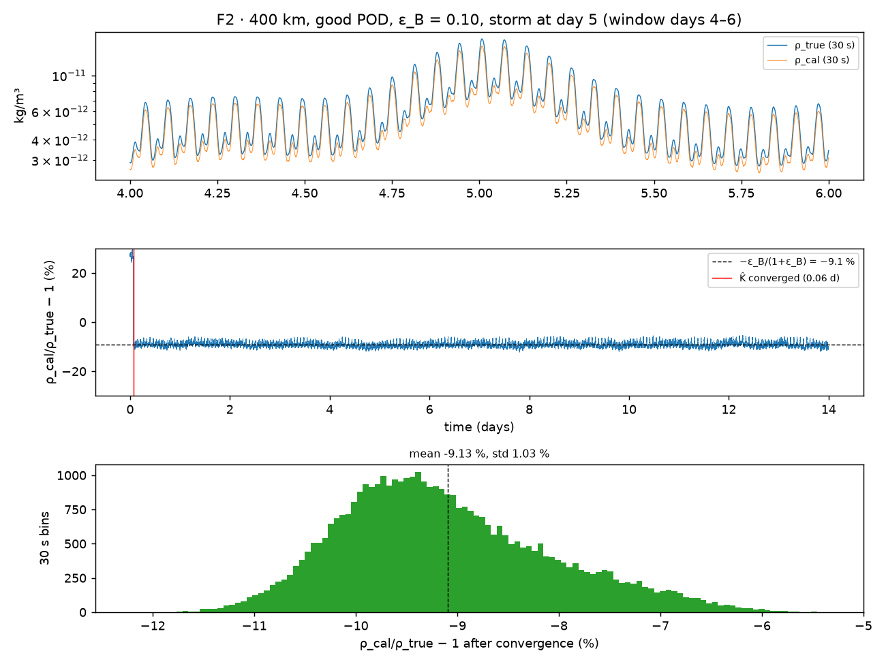

# clarity-anchor

A simulation that tests one idea: a cheap, drifting in-situ density gauge on a satellite can be
calibrated in orbit against the satellite's own GNSS orbit decay.

A spacecraft in low Earth orbit loses energy to drag on every orbit. Precise orbit determination
(POD) measures that loss without drift, but only as an average over a whole orbit. A cheap gauge
(for example a cold-cathode gauge behind a ram-facing chamber) reads density every second, but its
scale factor is uncertain by tens of percent and drifts. This repo fits the gauge's scale factor
to the POD drag work, arc by arc, with a scalar Kalman filter. If it works, the output is the
gauge's 30-second resolution with the POD's absolute accuracy.

Context: LINC Innovations is exploring this concept for the NASA TechLeap Orbital Clarity Challenge
(https://occ.nasatechleap.org). This is our own work; it is not affiliated with or endorsed by NASA.

**90-second explainer video:** [https://youtu.be/0Iho34Nu2k0](https://youtu.be/0Iho34Nu2k0)

## Results (synthetic NRLMSIS 2.0 truth, 14 days, gauge seed K(0) = 1.274 — farthest from nominal of 10 seeds)

Every number below is copied from [`results/summary.md`](results/summary.md), which the code
regenerates. Benchmarks are the challenge's in-situ density targets: accuracy ≤ 20 %,
precision ≤ 10 %, resolution ≤ 30 s.

| Finding | Value |
|---|---|
| Calibration lock-in, 300–500 km, good POD, 1-orbit arcs | 0.06–0.07 d (one orbit), 10/10 gauge seeds |
| Calibration lock-in, 600 km, good POD | 0.47 d (1-orbit arcs), 0.20 d (3-orbit arcs) |
| Calibration lock-in, 600 km, COTS POD, 1-orbit arcs | marginal: median 2.18 d, max 12.08 d over 10 seeds; final posterior σ 5.0 % on the main seed |
| Precision after lock-in (30 s bins), no drag-model error | 1.1–3.4 % (0.9–1.1 % in the cells with a drag-model error) |
| Accuracy with a 10 % ballistic-coefficient model error | 9.13 % (bias = −ε/(1+ε): density reads low when B is overestimated) |
| Uncalibrated gauge, worst of 10 seeds | up to 29.5 % off |
| Drag work per orbit, 300 → 600 km | 627.8 → 4.7 J/kg (Δa 140 → 1.2 m) |
| Fleet of N hosts with independent 10 % C_D errors | RMS accuracy 9.0 % (N = 1) → 4.6 % (N = 5) |





Additional figures: [`results/F3.png`](results/F3.png) (accuracy vs ballistic-coefficient error),
[`results/F4.png`](results/F4.png) (convergence grid across altitudes, POD grades, and arc lengths),
[`results/F5.png`](results/F5.png) (fleet averaging across $N$ hosts).

## What this does NOT show

- **Truth and gauge share one model atmosphere.** The simulation tests calibration transfer, not
  the fidelity of any atmosphere model, and not a real gauge.
- **The host's ballistic-coefficient error passes straight through.** With a 10 % C_D model error
  the calibrated density is biased by about 9 %. More hosts average it down; nothing here removes it.
- **Not modeled** (from [`docs/DECISIONS.md`](docs/DECISIONS.md)):
  - Gravity-field model error in ΔE (truth and estimator share point mass + J2).
  - Earth albedo and infrared radiation pressure.
  - Thermal re-radiation (spacecraft thermal recoil).
  - Attitude-control and thruster accelerations (manoeuvre arcs are excluded by assumption).
  - Time-correlated POD errors (all POD noise here is white per 10 s epoch).
  - Gauge response time (the 1 Hz gauge responds instantly).
- Composition sensitivity is modeled only through a fixed per-species gauge factor; the chamber
  gas dynamics are not simulated.

If you work on thermosphere density, satellite drag or neutral gauges and see a flaw, please open
an issue. A negative result is useful to us.

## Reproduce

Requires Python 3.12 and [uv](https://docs.astral.sh/uv/). Runs fully offline.

```bash
uv sync
uv run pytest                                  # 32 tests, including analytic checks
uv run python -m clarity_anchor.run --fig all  # regenerates results/ (~6-8 min)
```

Design: [`docs/sim-spec.md`](docs/sim-spec.md). Every choice the spec left open, every deviation,
and the reviewer findings: [`docs/DECISIONS.md`](docs/DECISIONS.md).

## License

MIT License — see [`LICENSE`](LICENSE).
